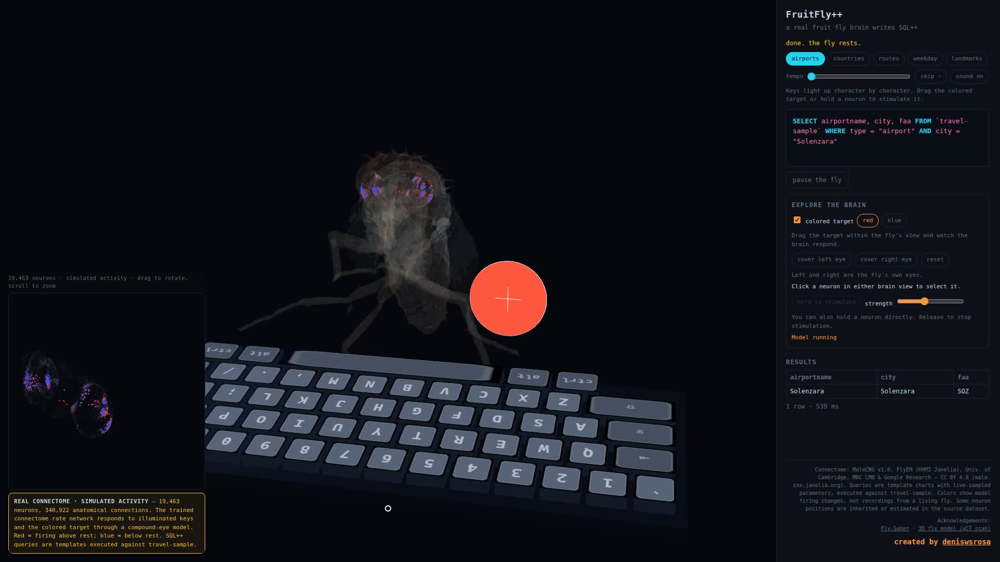

# FruitFly++ 🪰

A webpage where a fruit fly with a **MaleCNS v1.0 visual-to-motor rate network**
(19,463 neurons, 340,922 anatomical connections) responds to illuminated keyboard keys and a draggable colored target. The original trained model and compound-eye renderer come from
[Fly-Saber](https://github.com/jackie-0110/Fly-Saber). Red and blue show each
neuron's computed firing-rate change above and below gray-background rest.
SQL++ comes from template charts and **really executes** against a Couchbase
`travel-sample` cluster; the brain is not trained to generate SQL.

The fly mesh is a real µCT scan of an adult fruit fly (Sketchfab). Configure your
own Couchbase cluster using `.env`; database credentials are never bundled in
the client or committed to the repository. See [third-party notices](THIRD_PARTY_NOTICES.md).

---

## Demo video

[](docs/fruitflypp-demo.mp4)

[Watch or download the MP4](https://github.com/deniswsrosa/fruitflypp/blob/main/docs/fruitflypp-demo.mp4).
The silent 1080p recording shows character-by-character typing, real Couchbase
query results, front-leg grooming, target dragging, eye covers and neuron stimulation.
The neural responses are simulated; query selection still uses templates.

## Quick start

```bash
git clone https://github.com/deniswsrosa/fruitflypp.git
cd fruitflypp
cp .env.example .env
# Edit .env with your Couchbase query-service URL, username and password.
python3 -m venv .venv  # if the environment does not exist
.venv/bin/python -m pip install -r requirements-brain.txt
node server.js          # serves http://127.0.0.1:8788
```

Requires Node 22+ and Python 3.14 (the validated version).
No npm install or frontend build step. The Node server uses built-ins; neural
inference needs the Python packages in `requirements-brain.txt` (validated with
Python 3.14). `BRAIN_PYTHON` overrides the default `.venv/bin/python` interpreter.
Three.js r169 is vendored in `public/vendor/`. The model runs on CPU and warms up
when a viewer starts the demo. Pausing or disconnecting stops its worker.

After editing `public/main.js` or `index.html`:
1. bump the `?v=N` query in `index.html`'s `<script src="/main.js?v=N">` tag,
2. restart the server (`kill $(pgrep -f '^node server\.js$'); node server.js &`),
3. hard-refresh the browser (Ctrl+ShiftR). The server sends `Cache-Control: no-cache`,
   but the `?v=` bump is what reliably busts a stale tab.

Rebuild the fly assets only if you change the model pipeline or its classification
(needs the project `.venv` with numpy/trimesh/fast_simplification/matplotlib/scipy):

```bash
.venv/bin/python scripts/build_data.py       # data/body-annotations.feather -> positions.bin + regions.json
.venv/bin/python scripts/build_fly_glb_ct.py # CT-scan GLB -> public/fly.glb + public/fly-meta.json
```

`scripts/build_fly_glb.py` is the legacy pipeline for the old Thingiverse STL model —
kept for reference, do not run it unless you want to resurrect that mesh.

---

## Deployment

The current implementation needs a persistent Node process and Python/JAX workers.
Its neural session state is in memory and shared between streaming and input
requests, so use **one backend replica**. It is not a drop-in Vercel serverless
application. A future Vercel-only implementation can move neural inference into
browser workers and keep only short Couchbase queries in Node functions.

### Railway or another Docker host

1. Import this repository and let the host build the included `Dockerfile`.
2. Set `CB_QUERY_URL`, `CB_USER` and `CB_PASS` as service secrets.
3. Set `HOST=0.0.0.0`; the server honors the platform's `PORT` (default 8788).
4. Use one replica. Start with a 2 GB memory limit and measure actual usage;
   each active viewer starts its own CPU inference worker. No GPU is required.
5. Generate a public domain targeting the service port. Use `/api/health`
   for the health check.
6. Permit the backend's outbound IP addresses in your Couchbase network rules.
   Supply an appropriate CA using `NODE_EXTRA_CA_CERTS` when needed.

No Vercel project is necessary when the Docker service hosts the whole app.
The image uses the published model and assets; `.env` and `.venv` are excluded.

### VPS / local Docker

```bash
docker build -t fruitflypp .
docker run -d --name fruitflypp --restart unless-stopped \
  --env-file .env -e HOST=0.0.0.0 -e PORT=8788 \
  -p 127.0.0.1:8788:8788 fruitflypp
```

For a public VPS deployment, put an HTTPS reverse proxy in front of port 8788.
Keep proxy buffering off for `/api/brain/stream` and allow long-lived streams.

## Repo layout

```
server.js                    Node server: static files + paced token SSE + N1QL
brain-service.js             per-viewer Python worker lifecycle, eye input and activity SSE
requirements-brain.txt       CPU model dependencies
vendor/fly-saber/            original model, eye renderer and MIT license (see UPSTREAM.md)
public/
  index.html                 page shell, panel UI, intro overlay, credits, importmap
  main.js                    renderers, character typing, neural transport and query UI
  brain-interactions.js      target dragging, eye covers and selected-neuron stimulation
  typing-legs.js             CT foreleg skinning, joint IK and grooming animation
  foreleg-rig.json            reproducible foreleg triangle masks and rest joints
  brain/                     exact model-ordered neurons, eye columns and anatomical groups
  fly.glb                    the fly mesh, classified parts, vertex colors (~4.6 MB)
  fly-meta.json              anchors computed by the build script (head capsule, hips, wing pivots)
  vendor/                    three.module.js r169, OrbitControls.js, loaders/GLTFLoader.js,
                             utils/BufferGeometryUtils.js (keep three's dir layout)
data/
  body-annotations.feather   MaleCNS v1.0 annotations (CC BY 4.0) — source of the soma positions
  brain-model/               original real_fast checkpoint, manifest and matching subgraph
  positions.bin              legacy full soma cloud (141,781 points; not used by the live model)
  regions.json               legacy k-means display clusters (not anatomical regions)
scripts/
  brain_worker.py            original trained rate network + compound-eye rendering, 30 Hz
  rig_forelegs.py            creates foreleg triangle masks and joint metadata
  build_data.py              legacy feather -> positions.bin + regions.json
  build_fly_glb_ct.py        CT-scan GLB -> fly.glb + fly-meta.json (bake, decimate, classify, meta)
EXPLORATION.md               running lab journal of every iteration + hard-won gotchas (read it!)
README.md                    this file
```

## Server (`server.js`)

- Static handler serves anything under `public/` and `data/` (with a path-traversal
  guard). `GET /` → `index.html`.
- `GET /api/stream?chart=K&bpm=MS` → SSE stream, one "performance":
  events: `chart` {title} → (`beat` × N, `token` {t,k} every 2nd beat)… → `execute` → `result` {rows, elapsed_ms}.
- Charts are template token lists in `buildCharts()`; the SQL is exactly the tokens
  joined, so whatever the fly "types" is what runs. Placeholder values (cities,
  airports, landmark/activity pairs) are sampled live from the bucket in `loadScents()`
  with a fallback set if the cluster is unreachable.
- `n1ql()` posts to `CB_QUERY_URL` with `CB_USER` and `CB_PASS`, loaded from
  `.env` or the environment. Process environment variables take precedence.
  TLS verification is enabled by default. For a private certificate authority,
  configure `NODE_EXTRA_CA_CERTS`; `CB_TLS_VERIFY=false` is available for local
  development only. Results are capped at 25 rows.
- Without database configuration the brain and interaction demo still loads;
  executing SQL displays a configuration error until credentials are supplied.
- Tempo: `BEAT_MS` default 550; the client can pass `bpm`.

## Live brain pipeline

1. The client loads `public/brain/neurons.json`, retaining the original body-ID
   and row order. Coordinates use uniform scaling and a rigid orientation only.
   Resting colors in the main view identify biological pathway roles. Clicking
   a neuron selects its cell type, pathway role and body ID for direct stimulation.
2. `GET /api/brain/stream` starts a private Python model worker and sends a `ready`
   event. The worker checks the checkpoint counts, manifest neuron and edge hashes,
   and the browser export's exact body-ID ordering. The client checks every ready
   body ID against its own export before accepting activity.
3. `POST /api/brain/eye?id=SESSION` supplies projected illuminated key rectangles
   and the colored target in eye coordinates, at up to 30 Hz. The fly's gaze
   points at the keyboard. Only position, size, luminance and chroma enter the
   model; letter shapes, token text and SQL are not inputs. Drag events update
   the latest target position without flooding the network. Target movement is
   constrained to the fly's visual field. Rectangles, optics,
   luminance and color channels are idealized as in Fly-Saber, not a measured fly eye.
4. The original compound-eye renderer samples 437 columns. The original trained
   leaky rate network advances at 30 Hz with four Euler substeps, fixed synaptic
   topology, signed connections, learned parameters and neuromodulatory gains.
   Its saber-policy readout is unused in this SQL demo.
5. At 15 Hz the worker sends `activity` events containing a monotonic step and
   base64 signed int8 values: `clip(round((rate - rest) / 0.25 * 127), -127, 127)`.
   Array index i always identifies the same neuron i. Length mismatches and old
   frames are dropped. Visual input older than 2 seconds returns to gray; display
   data older than 1 second fades to zero. Eye covers persist until explicitly
   changed. Stimulation expires after 1 second without an input heartbeat. No synthetic random flashes are added.
6. The display maps activity with `sign(x) * min(1, sqrt(abs(x) / 32))` and eases
   toward each target with a 0.12-second time constant. A separate point shader
   uses normal blending, saturated vermilion/blue and fixed pixel sizes, preventing
   overlapping active neurons from washing out to white.
7. The brain widget sits at the bottom-left of the stage, with a ~378 px square
   renderer and its explanation beneath it. It has independent damped orbit
   controls and uses camera zoom 2.7 (50% above the previous 1.8). Its faint background sketch has opacity
   0.10; the in-head cloud has opacity 0.48. Both views share the same positions and
   activity attribute. The in-head brain follows head movement; the PiP has a
   separate fixed transform. `fitBrain()` waits for the model mesh and neuron data.

SQL chart selection, token generation and timing remain in `server.js`; none are
claimed to be a learned biological output. Original 141,781-soma assets are retained
for historical reference but are not mixed with the model's smaller neuron array.

## Keyboard and interactive experiments

The moving token blocks have been removed. Each token is queued and typed one
character at a time, including spaces and punctuation, highlighting its actual
ANSI key. The nearer front leg reaches toward that key and mimics a press. The
leg animation uses the CT mesh's own foreleg triangles, split without duplicating
or dropping faces, with hip/knee/ankle bones and smooth skin weights. Three-link
IK preserves segment lengths and clamps unreachable keys to the leg's reach;
this is a decorative typing animation, not the model's learned motor output.

Query SSE uses `once=1` for one chart at a time and paces tokens for character
animation. The client waits until all characters and the final press have been
shown before displaying results and scheduling the next chart. The displayed SQL
matches the statement executed by the server. After a result the two front legs
come together for five rubbing strokes, then return to rest; there is no jump.
Regenerate the leg metadata after changing the fly mesh with
`.venv/bin/python scripts/rig_forelegs.py`.

Explore the brain appears below the query. Drag the colored target or move it
with arrow keys when the main canvas is focused; red/blue changes its color
channel. Covering either eye masks only that side's compound-eye columns to the
gray resting input, in both luminance and chroma. These are sensory masks, not
neuron lesions. Reset restores the target and opens both eyes.

Click a neuron in either brain view to select it; hold for 320 ms to inject
current. Alternatively hold the stimulation button (pointer or Space/Enter).
Arrow keys in the focused brain view select neurons. The selected marker shares
the exact model index; no neighboring neuron is substituted. The chosen current
is applied through the original model's `iv.opto` vector, and the response is
computed through its synapses. Releasing, cancelling a pointer or losing focus
clears current. Full input snapshots carry increasing sequence numbers, so a
late request cannot reinstate an older stimulation command. Frames acknowledge
the applied controls. The model also clears current after one second without
an input update. Eye covers survive rendering delays; visual inputs tolerate a
two-second delay before reverting to gray.

The provenance text and linked acknowledgements stay at the bottom-right of the
sidebar while its query, experiments and results scroll above them. The footer
also links the creator credit to http://linkedin.com/in/deniswsrosa. The opening
emphasizes the real connectome and **Couchbase's travel-sample**, with the note
**IMPORTANT: The fruitfly is not a DBA.**

## The brain fit (`fitBrain()` + `fly-meta.json`)

`scripts/fit_brain.py` finds the largest uniform scale and translation fitting
all cranial neurons inside the convex envelope of the actual head and eye mesh,
contracted by 10% for clearance, with the center held behind the eye caps. The
eight ascending neurons have nerve-cord somata in the thorax/abdomen; these
remain in the simulation and retain their coordinates but do not constrain the
head fit. This replaces the thin ellipsoid near the front
of the head, which forced the brain to be too small. Coordinates and relative
neuron positions are preserved. The generated `public/brain/head-fit.json` records
the mesh and neuron asset hashes; the client rejects a mismatched neuron export.

After changing either asset, regenerate with `.venv/bin/python scripts/fit_brain.py`
(using the mesh pipeline's numpy/scipy/trimesh dependencies). The in-head cloud
stays attached to `brainAnchor`, so it follows breathing and typing motion. The
PiP uses a fixed copy of its transform with the previous ellipsoid framing to
preserve the user's existing zoom and orbit, sharing the position and activity
buffers with the in-head view.

The fly loader collects meshes before reparenting wings: mutating traversal
previously skipped a wing and left its opaque source material visible. Both
wings now receive the same translucent material and exactly one root pivot.
Keyboard positions advance from key edges and place each center at half its own
width, preserving a 0.022-unit gap across width changes. The keyboard tilts toward
the fly (180° yaw), with the space bar nearest its legs.

## Layer architecture (main camera vs PiP)

- Layer 0: fly, keyboard, draggable target, `cloudPts` and `cloudActivity`.
- Layer 1: fixed `cloudSketch` and an activity Points copy sharing the same geometry.
- Main camera sees layer 0; the independent PiP renderer sees layer 1 only.

Use `cloudPts` bounds when fitting or framing the brain, and wait for fitting to
finish before initializing the PiP center. Activity overlays must not alter the
anatomical bounding box.

## Data formats

- Legacy `positions.bin` (not loaded by the live viewer): `uint32 N`, then `N*3` float32 xyz (cloud-local, already
  normalized/rotated by nothing — rotation happens at runtime via `CLOUD_ROT`), then
  `N` uint8 region ids. Built from `data/body-annotations.feather` (MaleCNS
  `somaLocation` voxels, clipped, centered, normalized to [-1,1]).
- `fly-meta.json`: `headCenter`, `headRadii` [[+,-]×3], `headAxes` (3×3 rows),
  `eyeCenters`, `wingPivotL/R`, `hips`, `bounds`, `source`. All in baked model units
  (model is ~2 units long; `FLY_SCALE` 0.65 scales it into the scene). Recomputed by
  `scripts/build_fly_glb_ct.py` — never hand-edit.

## Build pipeline (`scripts/build_fly_glb_ct.py`)

1. Load the Sketchfab GLB (15 chunks), merge, **bake upright**: `(x, y, z) → (x, z,
   -y)` so the head faces +z (camera) and the dorsal side is +y. The scan pose is a
   walking fly — body axis horizontal.
2. Decimate to 120k triangles (`fast_simplification`), `fix_normals()`.
3. Classify triangles by rules tuned on matplotlib previews (`/tmp/fly_ct_classified.png`):
   - head: ellipsoid ctr (0, 0.80, 0.50), radii (0.33, 0.32, 0.30)
   - eyes: head ∩ z'>0.50 ∩ y'>0.68 (front-upper quadrant — real fly eyes dominate
     the head; sphere seeds over-select)
   - wings: big-area triangles, y'>0.78, z'<0, |x|>0.08
   - legs: KEPT on the mesh now (procedural stick legs were removed as awkward);
     `leg_mask` is still computed only to derive hip anchors for meta
4. Meta: headCenter = eye centroid + [0, 0.02, +0.02] (forward — a back-shifted
   center hid the brain behind the eyes); hips = leg-tri means near the root; wing
   pivots = wing front-edge means; capsule = head+eyes covariance, per-direction
   p2/p98 extents.
5. Export GLB with named parts (`body/head/eyes/wingL/wingR`) + vertex colors; the
   loader keys off these names.

## Dev workflow & test harness

- Screenshot/probe harness (zero-dep Node + Chrome DevTools Protocol on port 9222):
  - `/tmp/launch_cdp_chrome.sh` — fresh headless Chrome (1680×1000)
  - `/tmp/cdp_eval2.js <out.png> <url> <waitMs> "<js>"` — opens a tab, runs the JS
    (top-level; use an async IIFE for awaits), prints the result, dumps
    `__qf.debug()`, screenshots, reports JS exceptions.
  - `/tmp/cdp_check.js` — real click → chart starts.
- Validation:
  - `node --check public/main.js && node --check server.js && node --check brain-service.js`
  - `.venv/bin/python -m unittest discover -s tests -p 'test_*.py' -v`
  - `node --test tests/brain-service.test.js` (Node 22+ for the test fetch API)
  - Browser: start, verify model readiness, key-driven activity, target drag, eye covers, neuron
    stimulation/release, joint motion, grooming, pause/resume, and query results. Tests use a local query stub for browser checks;
    they do not establish remote Capella availability.
- **pkill footgun:** `pkill -f "<pattern>"` matches the shell's own cmdline — use
  anchored patterns (`pgrep -f '^node server\.js$'`) or the bracket trick
  (`'cdp-profil[e]'`), and never let the target string appear elsewhere in the same
  compound command (it will kill your own shell).

## Tuning knobs

| What | Where | Current |
|---|---|---|
| fly size / pose / position | `main.js` `FLY_SCALE`, `modelGroup.rotation.x`, `flyGroup.position.z` | 0.65 / -0.55 / +0.43 (y offset -0.035) |
| in-head brain clearance | `scripts/fit_brain.py` `CLEARANCE` | 10% inside the head envelope |
| camera zoom / target | `main.js` `PerspectiveCamera(32,…)`, `controls.target` | fov 32, (0,-0.05,0.45) |
| PiP size / rate / framing | `index.html` `#pip`, `main.js` `resizePip`, `pipCam.zoom` | bottom-left widget (~378 px), square, 25 fps, zoom 2.7 |
| cloud point size/opacity | `main.js` `loadBrain` material | 0.003 / 0.48 |
| sketch (PiP) size/opacity | `main.js` `cloudSketch` material | 1.1 screen pixels / 0.10, all neurons |
| model / stream rates | `scripts/brain_worker.py` | 30 Hz / 15 Hz |
| fly ghost opacity | `main.js` `MAT.*` (x-ray is permanent now) | 0.06 |
| keyboard layout/orientation | `main.js` `ROWS`, `kbGroup.rotation` | ANSI, 0.022-unit key gaps, pitch +0.22, yaw 180°, space row near fly |
| tempo / tokens per beat | `server.js` `BEAT_MS`, `TOKEN_EVERY_N_BEATS` | 550 / 2 |
| query row cap | `server.js` `runQuery` slice | 25 |
| Couchbase target | `server.js` `CB_QUERY_URL/CB_USER/CB_PASS` | configured using .env/environment variables |
| mesh triangle budget | `scripts/build_fly_glb_ct.py` `TARGET_TRIS` | 120,000 |

## Gotchas list (read EXPLORATION.md for the full stories)

- `meta` was once an implicit global (an empty `<meta>` DOM named-access shadowed the
  module var) — always use the module-level `flyMeta`.
- Keyboard material is an ARRAY: key top face is `key.material[2]`.
- The head capsule is TILTED vs the model axes — a model-axis-aligned ellipsoid
  leaks out of the back of the head. Always use `headAxes`.
- Procedural-leg lesson: leg offsets must be computed FROM THE HIP'S world position
  and inverse-rotated into model space (`M = Rx(+pitch)·(W/S)`), not from the
  absolute target. (Legs are mesh-native now; only relevant if re-adding rigs.)
- Row-flip lesson: don't reorder keyboard rows without checking label orientation —
  the physical 180° turn (`rotation.set(-0.42, π, 0)`) is how the keyboard faces the
  fly while labels stay correct for it.

## Fly-Saber reference and attribution

Cloned and reviewed [Fly-Saber](https://github.com/jackie-0110/Fly-Saber) at
`2bfb6aa`. Its unmodified `src/brain/model/brain.py`, config and interventions,
`src/brain/connectome/metadata.py`, and `src/fly_saber/eye.py` are vendored under
`vendor/fly-saber/src`. The original MIT license is preserved there. The checkpoint
and matching subgraph come from `data/bundles/real_fast`; browser exports come
from `frontend/public/data/brain`. Source and adaptation details are recorded in
`vendor/fly-saber/UPSTREAM.md`.

The two-pass rendering and index-preservation patterns follow
`frontend/src/features/brain/brain-scene.tsx` and `data.ts`; activity encoding follows
`src/server/saber_sim.py` and `docs/reference/PROTOCOL.md` section 6. This is a
connectome-constrained rate simulation with learned parameters and idealized optics,
not electrophysiology, a spiking-neuron model, or a model trained to understand SQL.
Some positions are inherited from partners or estimated from cell-type means; the
metadata and click inspector retain those provenance labels. MaleCNS source data
is CC BY 4.0, credited to FlyEM (HHMI Janelia), Cambridge, MRC LMB and Google Research.
